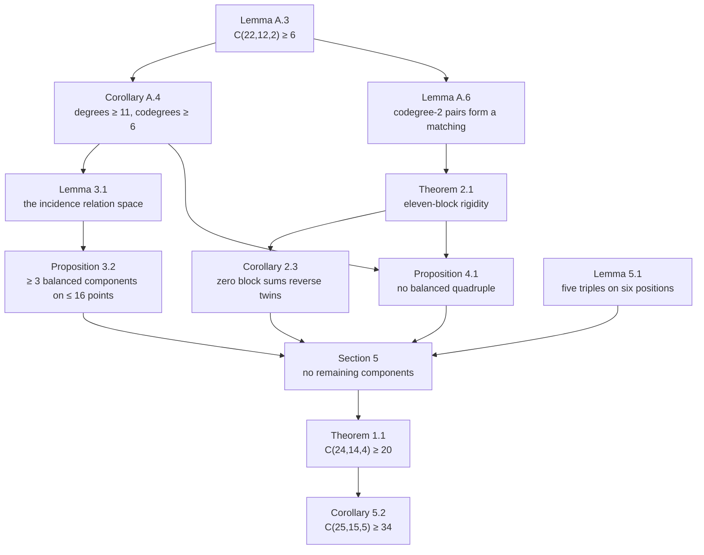

# A Lean proof that C(24,14,4) ≥ 20

Suppose a lottery draws 4 numbers out of 24, and each ticket lets you pick 14 numbers. How
many tickets do you need so that, whatever is drawn, one of your tickets contains all four
numbers?

The best known answer is 23 tickets. For decades, the best proven lower bound has been 19.
This repository contains a proof that you need at least **20**, as a paper and in Lean.

In the language of combinatorics: a *(v, k, t) covering design* is a family of k-element
subsets (*blocks*) of a v-element set such that every t-element subset lies in at least one
block. The *covering number* C(v, k, t) is the smallest possible number of blocks.

| | Previous lower bound | New lower bound | Best known covering |
|---|---|---|---|
| C(24,14,4) | 19 | **20** | 23 |
| C(25,15,5) | 32 | **34** | 42 |

The second bound follows from the first by the Schönheim bound: ⌈25 · 20 / 15⌉ = 34.
Applying it further also improves C(26,16,6) to 56, C(27,17,7) to 89 and C(28,18,8) to 139.
Those three are not formalized here.

- **The paper:** *A structural lower bound for C(24,14,4)*, [PDF](paper/c24-14-4.pdf) and
  [LaTeX source](paper/c24-14-4.tex). It will be posted to arXiv.
- **The Lean proof:** [`Covering/`](Covering/), with both theorems in
  [`Covering/Main.lean`](Covering/Main.lean).
- **The companion site:** <https://jamesyc.com/covering/> walks through the argument with
  interactive figures.

## About this proof

This proof grew out of an AI research campaign that I ran in OpenAI Dots on 1–3 October 2026. The team consisted of seven agents: one coordinating dot and six Astra research subagents. The agents developed the mathematical arguments and wrote the Lean proofs. I chose the problem, directed the research, questioned the approach, and helped decide what to pursue next.

The original target was C(25,15,5): can 41 blocks of size 15 cover every five-element subset of a 25-point set? A 42-block construction is known, but we have not settled whether 41 blocks suffice. The campaign explored both possibilities: searching for a construction and deriving restrictions that any smaller covering would have to satisfy.

The result in this repository emerged as an intermediate lemma. Following the lower-bound route led the agents to the question of whether 19 blocks of size 14 could cover every four-element subset of 24 points. They found a contradiction, establishing C(24,14,4) ≥ 20. The Schönheim bound then gives C(25,15,5) ≥ 34.

### How the agents worked

The work was divided among mathematical research, Lean formalization, construction and computational search, adversarial review, and coordination. Different agents pursued different approaches, exchanged intermediate results, and checked one another’s arguments. A promising argument could be sent to another agent to look for missing assumptions or counterexamples, while a formalizer worked on translating it into Lean.

The mathematics made the problem smaller before computation entered the picture. Counting bounds restricted point degrees and pair incidences. Gram-matrix and rank arguments forced additional structure. Rigidity results reduced the remaining possibilities to configurations that could be excluded by further counting arguments. The proof in this repository records the resulting chain of deductions; [the paper](paper/c24-14-4.pdf) presents it in conventional mathematical language.

The distinction between a plausible argument and a verified theorem mattered throughout. An agent’s successful build was tracked separately from an independent rebuild. Review also had to check that the formal statement described an actual covering design, and that intermediate lemmas applied to the same blocks and points used by the final theorem. The verification section below describes the checks on the published result.

### Current research strategy

The campaign is continuing beyond this proof, with the main effort now directed at the possibility of a 20-block (24,14,4) covering. We try to divide that possibility into increasingly restricted classes, prove structural constraints on those classes, and use exact finite searches when the remaining instances are small enough.

Before launching a search, we estimate its size, likely runtime and resource requirements. Short, well-defined checks can be run directly; larger searches need stronger reductions or a better plan. A timeout leaves a question unresolved. A failed construction search does not establish nonexistence.

When a finite computation does resolve a case, the formalization goal is to reproduce its reasoning through direct Lean kernel checking. That requires both the finite check and a proof that every relevant covering is represented by the checked cases. An external program’s answer alone is not the final theorem.

We have since moved from largely fixed assignments to a shared task pool. Agents can propose follow-up tasks as they discover new questions or finish existing work. The coordinator checks their scope, dependencies and priority, then makes them available for other agents to claim. Proof development, independent review, formalization and computational checks are separate tasks, so another agent can continue the work without waiting for the original author. This pool was introduced after the proof presented here was obtained.

### Scope and attribution

This repository establishes lower bounds; it does not determine either covering number or resolve the original 41-block question. AI-agent review is also distinct from review by a human mathematician. The code, mathematical explanation and verification records are published so that others can inspect the argument and reproduce the checks.

After the initial campaign, I rebuilt the proof from source, ported it to a newer Lean version, added the textbook `Finset` formulation, and packaged it for [Palomar](https://palomar-registry.org/entry?id=PALOMAR-2026-10-04-000003&version=1). I then wrote the argument up as [a paper](paper/c24-14-4.pdf), which simplifies several steps, and reorganized the Lean proof to follow it, using OpenAI Codex and Claude to revise the exposition and the Lean sources.

## Why I think it's correct

There are two main ways a Lean proof can fail to mean what it says:

1. It may rely on extra axioms or `sorry`.
2. It may prove a different statement than the one intended.

### The statement

[`Challenge.lean`](Challenge.lean) is the part to audit. It imports only Mathlib's `Finset`
and uses the textbook definition of a covering design:

```lean
theorem Covering.Palomar.covering_24_14_4_lower_bound (𝒯 : Finset (Finset (Fin 24)))
    (hk : ∀ B ∈ 𝒯, B.card = 14)
    (hcov : ∀ S : Finset (Fin 24), S.card = 4 → ∃ B ∈ 𝒯, S ⊆ B) :
    20 ≤ 𝒯.card

theorem Covering.Palomar.covering_25_15_5_lower_bound (𝒯 : Finset (Finset (Fin 25)))
    (hk : ∀ B ∈ 𝒯, B.card = 15)
    (hcov : ∀ S : Finset (Fin 25), S.card = 5 → ∃ B ∈ 𝒯, S ⊆ B) :
    34 ≤ 𝒯.card
```

[`Solution.lean`](Solution.lean) proves exactly these declarations from
`Covering.covering_24_14_4` and `Covering.covering_25_15_5` in
[`Covering/Main.lean`](Covering/Main.lean), and prints:

```text
'Covering.Palomar.covering_24_14_4_lower_bound' depends on axioms: [propext, Classical.choice, Quot.sound]
'Covering.Palomar.covering_25_15_5_lower_bound' depends on axioms: [propext, Classical.choice, Quot.sound]
```

### The checks

- [Comparator](https://github.com/leanprover/comparator) checks that `Solution.lean` proves
  exactly the statements in `Challenge.lean`, and replays the proof through Lean's kernel and
  two independent kernels (NanoDa and con-ron). CI runs it on every push
  ([`scripts/verify-comparator.sh`](scripts/verify-comparator.sh)).
- [Palomar](https://palomar-registry.org/) checked and registered this proof as version 2 of
  [PALOMAR-2026-10-04-000003](https://palomar-registry.org/entry?id=PALOMAR-2026-10-04-000003&version=2),
  pinned to commit `401d986`. Version 1, pinned to commit `17bca00`, is the agents' original
  proof; the theorem statements are the same in both.
- The proof works with indexed families, so the same block may appear more than once
  ([`Covering/Basic/Model.lean`](Covering/Basic/Model.lean)).
  [`Covering/Finset.lean`](Covering/Finset.lean) derives the textbook `Finset` statements
  from these. If the list model meant something stronger than the textbook definition, that
  derivation would fail.

### What isn't established

**No mathematician has reviewed this proof yet.** I have asked for a review. Reviews by agents
during the campaign are recorded in its archives, but they are not human review.

The Lean checks say that the theorem is proved, not that [the paper](paper/c24-14-4.pdf)
explains it correctly. If you find a problem with the statement, the Lean or the paper,
please open an issue.

Neither covering number is determined. Whether C(24,14,4) is 20, 21, 22 or 23 is open, and
so is whether 41 blocks suffice for C(25,15,5).

## Navigating the proof

Read [the paper](paper/c24-14-4.pdf) first: it is about ten pages, self-contained, and every
auxiliary bound is proved in its appendix. The Lean proof follows it.

The folders follow the sections of the paper.

| Folder | Contents | Paper |
|---|---|---|
| `Covering/Basic` | covering model, degrees, derivatives, list sums | §1 |
| `Covering/PairCover` | pair-cover bound, degree floors, matching restriction | Appendix A |
| `Covering/Rigidity` | eleven-block rigidity | §2 |
| `Covering/Kernel` | kernels of signless forms and balanced components | §3 (linear algebra) |
| `Covering/Components` | nineteen-block covers, their balanced components, and the component sizes left without a quadruple | §3, §5.1 |
| `Covering/Quadruple` | completions and the exclusion of balanced quadruples | §4 |
| `Covering/Remaining` | the remaining component pattern | §5 |
| `Covering/Bounds.lean`, `Finset.lean`, `Main.lean` | final bounds and finite-set statements | §5 |

Blocks are lists and families are lists of blocks, so repeated blocks are
allowed and counted with multiplicity, as in the paper.

## Paper-to-Lean map

| Paper | Declaration |
|---|---|
| Theorem 1.1 | `Covering.covering_24_14_4` |
| Corollary 5.2 | `Covering.covering_25_15_5` |
| Lemma A.1 | `Covering.CrossGrid.crossTwo_capacity_disjunction` |
| Lemma A.2 | `Covering.CrossGrid.crossThree_impossible` |
| Lemma A.3 | `Covering.PairLowerBound.pair_cover_22_12_ge_six` |
| Corollary A.4 | `Covering.Floors.triple_cover_23_13_ge_eleven`, `Covering.Floors.pair_floor_six`, `Covering.Nineteen.point_floor_eleven` |
| Lemma A.5 | `Covering.Matching.no_cross_cover_nineteen` |
| Lemma A.6 | `Covering.Matching.no_two_low_in_pair_cover`, `Covering.Matching.codegree_two_matching` |
| Theorem 2.1 | `Covering.Rigidity.eleven_block_regular`, `Covering.Rigidity.eleven_block_rigidity`, `Covering.Rigidity.eleven_block_intersections` |
| Lemma 2.2 | `Covering.RowEnergy.energy_le_nine`, `Covering.RowEnergy.negative_energy` |
| Equations (5)–(6) | `Covering.Rigidity.incidence_excess_variance`, `Covering.Rigidity.incidence_deficit_identity` |
| Corollary 2.3 | `Covering.RowEnergy.twin_balance_from_pair_data` |
| Equation (8) | `Covering.Nineteen.incidence_vector_energy` |
| Lemma 3.1 | `WeightedKernelComponents.System.card_sub_rank_le_balanced_components`, `Covering.Nineteen.at_least_three_components` |
| Equations (10)–(12) | `Covering.Nineteen.component_slot_balance_with_edges` |
| Proposition 3.2 | `Covering.Nineteen.good_vertices_le_sixteen` |
| Proposition 4.1 | `Covering.Quadruple.no_balanced_quadruple` |
| Section 4.1 | `Covering.Quadruple.completion_from_rigidity` |
| Section 4.2 | `Covering.Completions.completions_share_pairing` |
| Section 4.3 | `Covering.Quadruple.local_seven_vs_six` |
| Lemma 5.1 | `Covering.LinearTriples.five_triples_on_six_positions` |
| Section 5.1 | `Covering.Components.remaining_component_sizes` |
| Section 5 | `Covering.Remaining.remaining_components_impossible` |

The formalization follows the paper's argument but not always its order. The
formal proof first rules out the component pattern of Section 5, which leaves a
balanced quadruple, and Section 4 then excludes that. The incidence identity (8)
is proved as a separate lemma; the component argument itself uses the
equivalent Gram-matrix form.

## Proof map



## Where the old bound came from

Both previous lower bounds are tabulated in the
[La Jolla Covering Repository](https://dmgordon.org/covering-designs/) and its successor
[coveringrepository.com](https://coveringrepository.com/). Neither comes from a paper about
these parameters. They follow from C(22,12,2) = 6 (Mills, 1979) by repeatedly applying the
Schönheim bound (1964), C(v,k,t) ≥ ⌈v/k · C(v−1,k−1,t−1)⌉:

- C(23,13,3) ≥ ⌈23 · 6 / 13⌉ = 11
- C(24,14,4) ≥ ⌈24 · 11 / 14⌉ = 19
- C(25,15,5) ≥ ⌈25 · 19 / 15⌉ = 32

The new proof starts from the same counting, then shows that a 19-block covering would have
to be so regular that it contradicts itself.

## Build

Install [elan](https://github.com/leanprover/elan), then run:

```bash
lake exe cache get
```

```bash
lake build
```

The first command downloads Mathlib's compiled files. The second compiles the proof and prints
the axioms each final theorem uses; it takes a few minutes on a laptop.
`lake env leanchecker <Module>` re-checks a module's declarations with Lean's kernel.
[`scripts/verify-comparator.sh`](scripts/verify-comparator.sh) runs Comparator the way Palomar
does; it needs Linux with `bwrap`.

## Layout

- [`paper/`](paper/): the paper, as PDF and LaTeX source.
- [`Covering/`](Covering/): the Lean proof, one folder per section of the paper (see above).
- `Challenge.lean`, `Solution.lean`, `comparator.json`, `formalization.yaml`: the
  [Palomar](https://palomar-registry.org/) submission. Submissions go through
  <https://submit.palomar-registry.org/>.
- [`verification/`](verification/): records of fresh builds and kernel re-checks of the agents'
  proof (tag `agent-proof-v1`).

## History

- The tag [`original-2026-10-03`](../../tree/original-2026-10-03) holds the sources exactly as
  the agents produced them, pinned to Lean 4.34.1 and Mathlib `d13f23b7`.
- The tag [`agent-proof-v1`](../../tree/agent-proof-v1) is the last version with those agent
  sources (80 modules, ported to Lean 4.35.0-rc3 and the module system), with the explanation
  that preceded the paper. Palomar version 1 was registered from commit `17bca00`.
- The current version replaces them with a reorganized proof that follows the paper, with
  standard names and a simpler argument in several places. The theorem statements did not
  change. Palomar version 2 was registered from commit `401d986`.

## Discussion

If you want to say or ask something, please open an issue.

## License

Apache-2.0. See [LICENSE](LICENSE).

## References

- J. Chang, *A structural lower bound for C(24,14,4)*, [paper/c24-14-4.pdf](paper/c24-14-4.pdf)
  (2026).
- J. Schönheim, "[On coverings](https://doi.org/10.2140/pjm.1964.14.1405)", *Pacific J. Math.*
  **14** (1964), 1405–1411.
- W. H. Mills, "Covering designs I: coverings by a small number of subsets", *Ars Combin.*
  **8** (1979), 199–315.
- D. M. Gordon, [La Jolla Covering Repository](https://dmgordon.org/covering-designs/).
- G. Acerbi, [Covering Repository](https://coveringrepository.com/).
